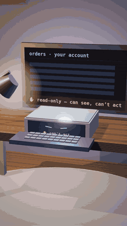
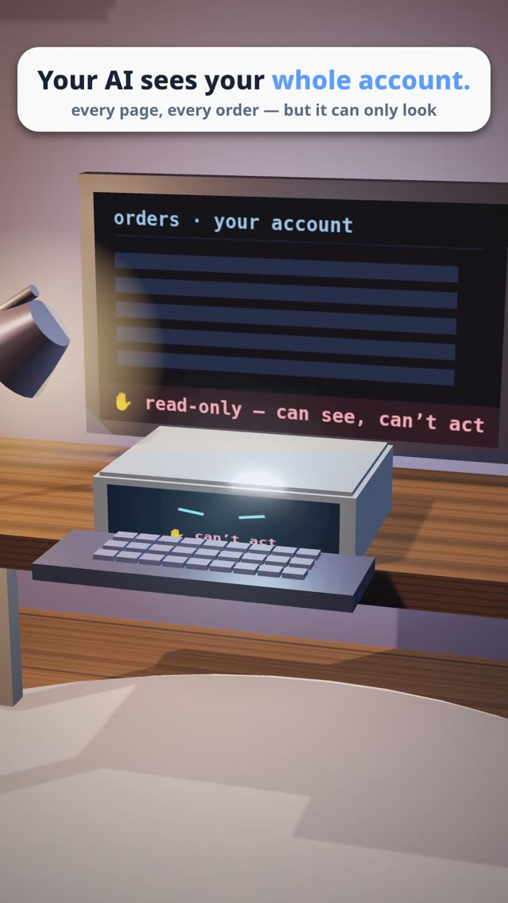
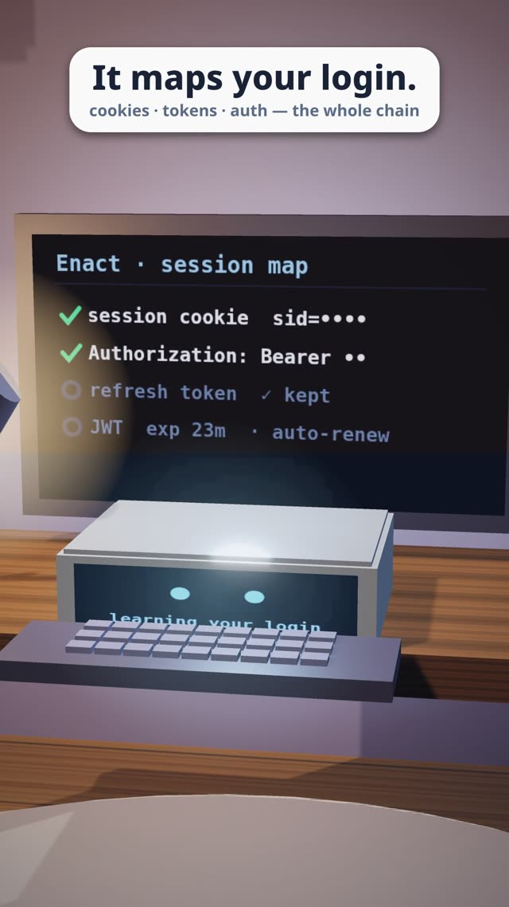
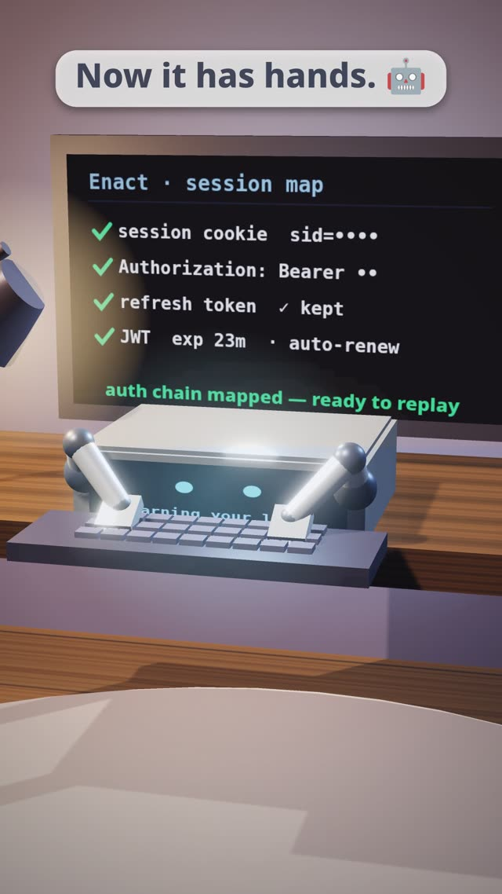
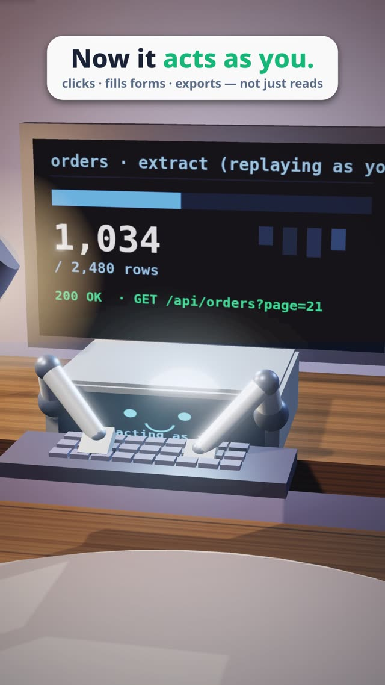
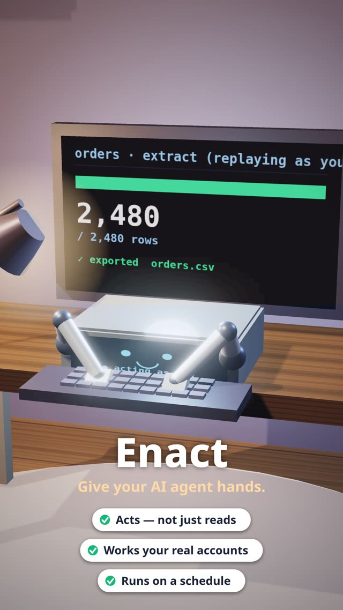

<div align="center">

# Enact

### Give your AI agent hands.

Your AI can *see* your whole account — but it can't *act*.<br>
Log in once. Enact learns your session and lets your agent work **as you**, through a real browser.

<br>



<br>

[▶ Watch the 29-second reel (MP4)](enact-demo.mp4) &nbsp;·&nbsp; [How it works](#how-it-works) &nbsp;·&nbsp; [Quick start](#quick-start) &nbsp;·&nbsp; [Boundaries](#boundaries-on-purpose)

  

</div>

---

> **Naming note.** The product is called **Enact**. The Python package and CLI keep the original working name `spyscan` (`spyscan record`, `from spyscan.agent import Spyscan`).

## The problem

An AI agent on your desktop can read a site — every page, every order — but a site is more than pages. Behind the UI there are cookies, bearer tokens, CSRF fields, one-time nonces and signatures computed in JavaScript. Without them the agent can look, but it can't do anything.

## The idea

Enact records **one** session that *you* log into, works out how that session is authorized, and then replays and automates requests **through a real browser** — so they are valid, not "an HTTP script" that breaks on one-time tokens and anti-bot defenses.

<table>
<tr>
<td align="center" width="25%"><br><sub><b>1 · It can only look</b><br>read-only — can see, can't act</sub></td>
<td align="center" width="25%"><br><sub><b>2 · It maps your login</b><br>cookies · tokens · auth chain</sub></td>
<td align="center" width="25%"><br><sub><b>3 · Now it has hands</b><br>ready to replay</sub></td>
<td align="center" width="25%"><br><sub><b>4 · It acts as you</b><br>fills forms · exports</sub></td>
</tr>
</table>

## How it works

```
record (your browser)  →  analyze  →  replay (a real browser)
   HAR + cookies          provenance     3 tiers + auto-refresh chains
```

- **Value provenance** — for every dynamic value (cookie, header, body field) Enact finds where it comes from: a prior response, `Set-Cookie`, a meta tag, a double-submit seed, or "computed in JS" — and builds the dependency chain.
- **Auto-refresh** — before a replay it re-runs the origin requests and pulls fresh tokens, cookies and one-time nonces, so the snapshot never goes stale. It re-authenticates on `401`.
- **Three replay tiers**
  1. raw HTTP (`httpx`) — the fast path for simple endpoints;
  2. in-browser `fetch` — the request runs from the live page with live cookies and an honest fingerprint;
  3. action replay — the page itself produces the request (including JS signatures), captured via interception.
- **Reliability** — retries with exponential backoff on `429` / `5xx`.
- **Privacy x-ray** — tracker database (60+), leak detection (JWT / keys / PII), cookie audit.
- **Data-flow map** — a built-in canvas view of the traffic, no external library.

## For agents

`spyscan analyze` writes agent-first artifacts next to the capture:

| File | What it is |
|---|---|
| `agent.json` | machine-readable manifest: operations, params, returns, rules |
| `tools.json` | ready function-calling schemas — one tool per operation — to hand to an LLM |
| `AGENT.md` | how to use it, the full map, the ready-made tasks |

And the simplest path is a small facade:

```python
from spyscan.agent import Spyscan

with Spyscan.open("capture") as sp:
    sp.find("balance")                              # fuzzy search over operations
    r = sp.call("GET /cloud/v2/instances", page=2)  # -> status, parsed data, shape
    sp.collect("GET /cloud/v1/os-images/")          # all pages -> rows
```

## Quick start

```bash
python3 -m venv .venv && . .venv/bin/activate
pip install -e .
playwright install chromium
```

```bash
# 1) record a session (a browser opens — log in and browse, then press Enter)
spyscan record https://site.example --out ./capture

# 2) analyze → session.json, openapi.json, AGENT.md, REPORT.md, agent.json, tools.json
spyscan analyze ./capture

# 3) open the report (data-flow map + readable report)
spyscan report ./capture                  # http://127.0.0.1:8088

# 4) put it to work
spyscan collect ./capture "GET /cloud/v2/instances" --out instances.csv   # export to a table
spyscan action  ./capture --set "sel=value" --allow-writes                # replay clicks / forms
spyscan bulk    ./capture --endpoint "POST /..." --items items.json --allow-writes
spyscan monitor ./capture --endpoint "GET /..."                           # snapshot + diff
spyscan scrub   ./capture                                                 # safe copies without secrets
```

No real site at hand? Try the built-in target:

```bash
python scripts/demo.py           # record → analyze → replay
python scripts/demo.py --serve   # + the map on :8088
```

## Boundaries (on purpose)

Enact is for **your own, authorized sessions**. These limits are part of the design:

- Replay goes through a **real browser** — the fingerprint is genuine. **No JA3/TLS spoofing, no stealth or anti-fingerprinting.**
- CAPTCHAs and 2FA are **detected and handed to a human — never bypassed**, and there are no third-party solvers.
- Third-party anti-bot WASM signatures are **not cracked** — the site signs in your browser, as it normally does.
- Writes (`POST` / `PUT` / `PATCH` / `DELETE`) are **dry-run by default**; sending for real needs `--allow-writes`.
- Local-first: nothing "phones home". The only optional network dependency is `three.js` for the 3D page.

## The reel

The promo reel in this repo is rendered from code — no footage. A deterministic `window.__frame(i)` draws every frame of a three.js scene, and `demo/render.py` captures it with headless Chromium and encodes it with ffmpeg.

```bash
python demo/bed.py 29 demo/build/bed6.wav                                  # synthesized music bed
REEL=demo6.html REELOUT=enact-hands REELAUDIO=bed6.wav python demo/render.py video
REEL=demo6.html python demo/render.py stills 1 10 18                       # single frames (seconds)
```

<div align="center">

</div>

## Project layout

| Path | Contents |
|---|---|
| `src/spyscan/` | recorder, analyzer, provenance, replay, browser, interceptor, privacy, export, agent kit, server |
| `web/` | report UI (data-flow map) |
| `tests/` | unit tests + end-to-end browser tests against a local target |
| `scripts/` | built-in demo target |
| `demo/` | the code-drawn promo reels (three.js) and their renderer |

## Stack

Python 3.10+ · Playwright + Chromium · FastAPI · vanilla-JS canvas · three.js (reel) · numpy (reel audio).

## Tests

```bash
python -m pytest        # 62 tests: logic + e2e in a real browser
```

## License

MIT
